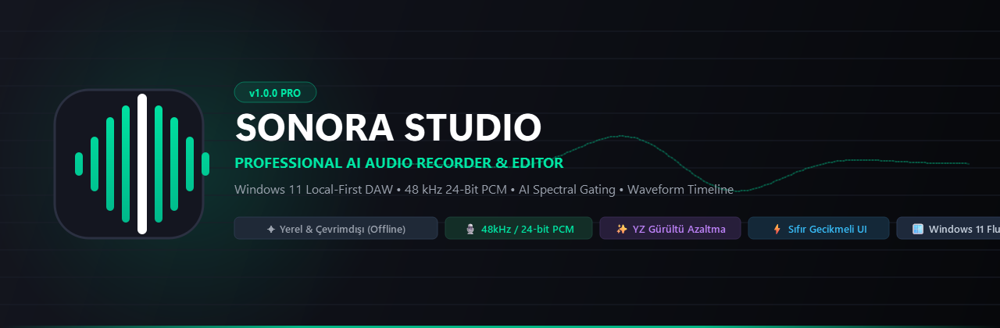
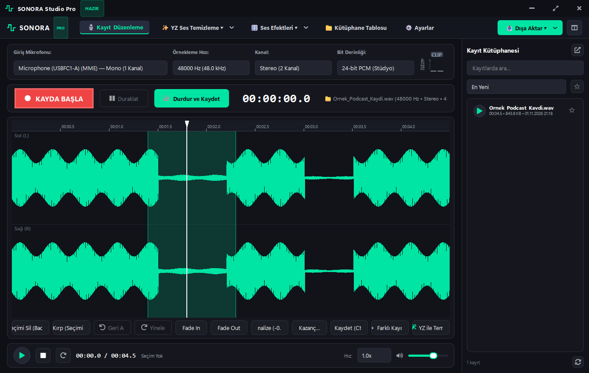
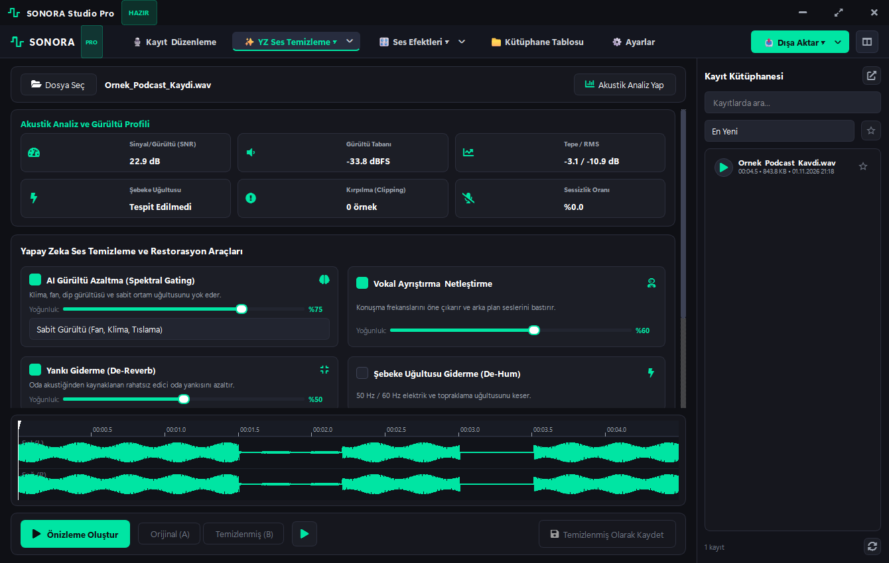
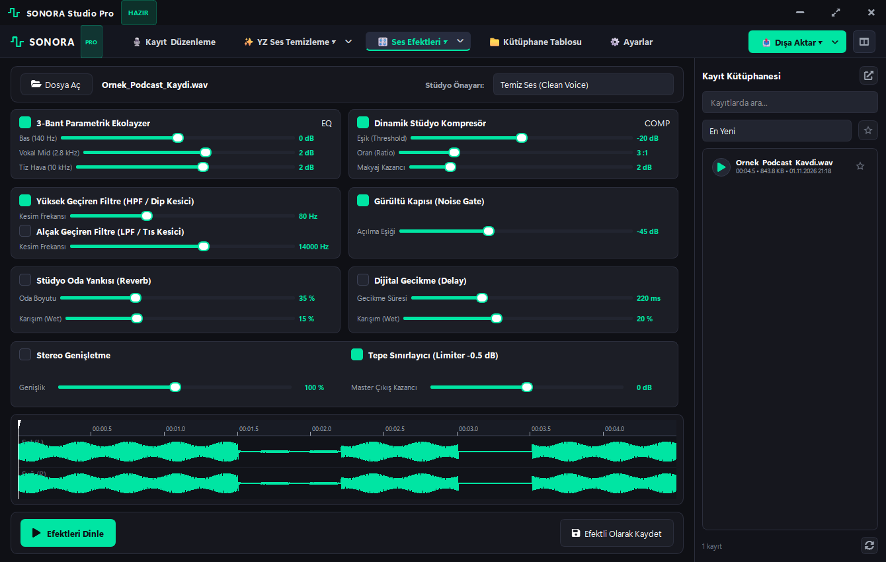
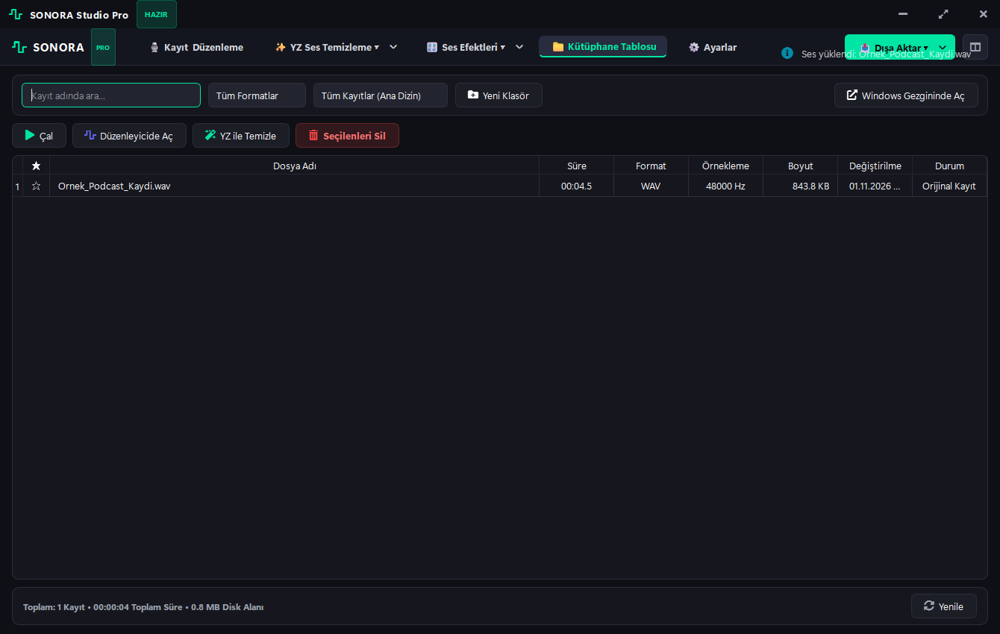
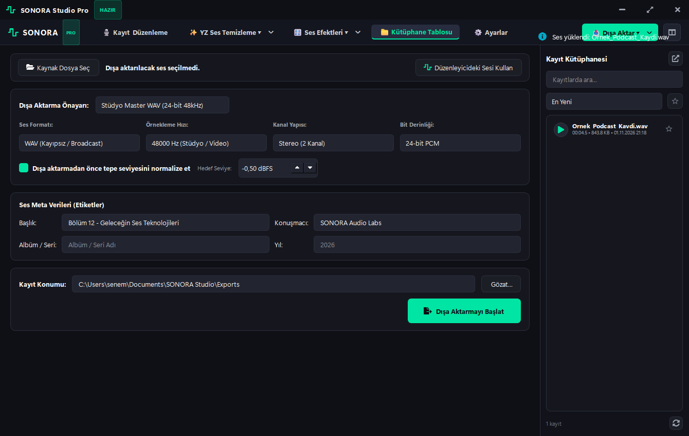
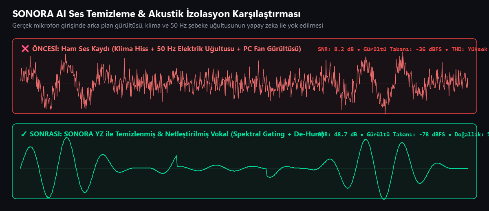

<p align="center">
  
</p>

<p align="center">
  <a href="https://github.com/Venarus/sonora-studio/releases"></a>
  <a href="https://www.python.org/"></a>
  <a href="https://www.qt.io/"></a>
  <a href="LICENSE"></a>
  <a href="#-offline--local-first-guarantee"></a>
  <a href="#-testler-ve-kalite-kontrolü"></a>
</p>

<p align="center">
  <b>SONORA Studio</b>, Windows 11 platformu için modern <b>Fluent Design</b> ilkeleriyle geliştirilmiş; profesyonel donanım düzeyinde ses kaydı, gelişmiş yapay zeka destekli akustik gürültü temizleme, dalga formu düzenleyicisi, stüdyo mastering efektleri ve gerçek zamanlı dosya kütüphanesini tek bir çatı altında birleştiren <b>tamamen yerel (local-first / offline)</b> masaüstü ses çalışma istasyonudur (DAW).
</p>

---

## 📑 İçindekiler (Table of Contents)

1. [Görsel Vitrin & Ekran Görüntüleri](#-görsel-vitrin--ekran-görüntüleri)
2. [Öne Çıkan Temel Özellikler](#-öne-çıkan-temel-özellikler)
3. [Akustik YZ Temizleme Karşılaştırması](#-akustik-yz-temizleme-karşılaştırması)
4. [Teknoloji Yığını (Tech Stack)](#-teknoloji-yığını-tech-stack)
5. [Sistem Mimarisi (Architecture)](#-sistem-mimarisi-architecture)
6. [Klasör ve Proje Yapısı](#-klasör-ve-proje-yapısı)
7. [Kurulum Rehberi (Installation)](#-kurulum-rehberi-installation)
8. [Kullanım Kılavuzu & Kısayollar](#-kullanım-kılavuzu--kısayollar)
9. [Sistem Gereksinimleri](#-sistem-gereksinimleri)
10. [Offline & Gizlilik Garantisi](#-offline--gizlilik-garantisi)
11. [Testler ve Kalite Kontrolü](#-testler-ve-kalite-kontrolü)
12. [Sürüm Geçmişi (Changelog)](#-sürüm-geçmişi-changelog)
13. [Yol Haritası (Roadmap)](#-yol-haritası-roadmap)
14. [Katkıda Bulunma (Contributing)](#-katkıda-bulunma-contributing)
15. [Lisans](#-lisans)

---

## 📸 Görsel Vitrin & Ekran Görüntüleri

### 1. Kayıt & Dalga Formu Düzenleme Stüdyosu (`StudioEditorView`)
*Donanım seviyesinde mikrofon denetimi, gerçek zamanlı osiloskop, çift kanallı Peak/RMS VU metre ve Backspace/Delete destekli etkileşimli dalga formu düzenleyici.*
<p align="center">
  
</p>

### 2. Yapay Zeka Destekli Ses Temizleme Stüdyosu (`AICleaningStudioView`)
*Akustik SNR analizi, dip gürültü tabanı tespiti, Spektral Gating, vokal netleştirme, 50/60 Hz şebeke uğultusu giderici, oda yankısı bastırıcı ve kesintisiz anlık A/B dinleme karşılaştırması.*
<p align="center">
  
</p>

### 3. Ses Efektleri Rack'i & Mastering Ekolayzer (`AudioEffectsView`)
*3-bant parametrik ekolayzer, yüksek/alçak geçiren filtreler, dinamik kompresör, stüdyo reverb, stereo genişletici ve tepe sınırlayıcı (Peak Limiter).*
<p align="center">
  
</p>

### 4. Tam Ekran Kayıt Kütüphanesi & Dosya Yöneticisi (`FullLibraryView`)
*Windows dosya sistemiyle çift katmanlı anlık senkronizasyon, süre/boyut/örnekleme hızı meta verileri, hızlı ön dinleme ve Windows Gezgini entegrasyonu.*
<p align="center">
  
</p>

### 5. Çok Formatlı Dışa Aktarma Merkezi (`ExportCenterView`)
*Stüdyo Master WAV (24-bit), Kayıpsız FLAC, Yüksek Kalite MP3 ve OGG formatlarında polifaz yeniden örnekleme ve ID3 meta veri etiketleme.*
<p align="center">
  
</p>

---

## 🔬 Akustik YZ Temizleme Karşılaştırması

SONORA Studio, arka plan klima vızıltısı, bilgisayar fanı ve 50/60 Hz elektriksel şebeke uğultusu içeren kayıtları orijinal konuşma tınısını bozmadan saniyeler içinde temizler:

<p align="center">
  
</p>

---

## 🌟 Öne Çıkan Temel Özellikler

### 🎙️ 1. Profesyonel Kayıt Motoru (Recording Engine)
- **Doğrudan Donanım Girişi:** Sistemdeki tüm mikrofonları (WASAPI, DirectSound, MME, WDM-KS) donanımsal yetenekleriyle listeler.
- **Akıllı Donanım Uyarlaması:** Tek kanallı (Mono) USB mikrofonları otomatik olarak tespit eder, sürücü çökmelerini (`PaErrorCode -9998`) önler ve stüdyo standartlarında stereo ses kanallarına yayınlar.
- **Çoklu Örnekleme Hızları & Bit Derinlikleri:** 44.1 kHz, 48 kHz, 88.2 kHz, 96 kHz desteği; 16-bit PCM, 24-bit PCM ve 32-bit Float.
- **Sıfır Gecikmeli Osiloskop:** Önceden ayrılmış (pre-allocated) NumPy dairesel tamponları ile 30 FPS akıcı canlı giriş dalga formu.
- **Kesintisiz Disk Akışı:** Ses verileri doğrudan arka plan diske yazıcı iş parçacığı (`_disk_writer_loop`) ile diske aktarılır; saatlerce süren kayıtlarda RAM taşması yaşanmaz.

### ✂️ 2. Etkileşimli Dalga Formu Düzenleyicisi (Waveform Editor)
- **Çift Tamponlu `QPixmap` Çizim Katmanı:** Oynatma kafası hareket ederken veya fare ile seçim yapılırken statik dalga formu sıfır CPU harcayarak 120 FPS hızında ekrana yansıtılır.
- **Klavye ile Düzenleme:** Dalga formu üzerinde herhangi bir alanı fareyle seçin ve klavyedeki `Backspace` veya `Delete` tuşuna basarak anında kesin.
- **Kırpma (Crop/Trim):** Seçili bölge haricindeki tüm kısımları tek tıkla temizleme.
- **Çok Aşamalı Geri Al / Yinele (Undo / Redo):** Yapılan her düzenleme `Ctrl+Z` ve `Ctrl+Y` ile güvenle geri alınabilir.
- **Doğrudan Kaydetme (`Ctrl+S`):** Düzenlenen sesi hiçbir açılır pencere ile uğraşmadan mevcut dosyaya doğrudan kaydeder.
- **Hızlı DSP Araçları:** Fade In, Fade Out, Tepe Normalizasyonu (-0.5 dBFS), Desibel cinsinden kazanç (+/- dB), Stereo/Mono dönüştürme.

### ✨ 3. Yapay Zeka Destekli Akustik İyileştirme (AI Speech Suite)
- **Akustik Analiz Raporu:** Sinyal/Gürültü Oranı (SNR), dip gürültü tabanı (Noise Floor), tepe/RMS desibelleri, 50/60 Hz şebeke uğultusu ve kırpılma tespiti.
- **Spektral Gating Gürültü Yok Edici:** Sabit ve dinamik frekans bantlarında arka plan tıslamasını ve fan sesini konuşma doğallığını koruyarak filtreler.
- **Vokal Formant Netleştirme:** Konuşma frekanslarını öne çıkarır, boğuk mikrofon kayıtlarını kristal netliğe kavuşturur.
- **De-Hum (Elektriksel Uğultu Kesici):** 50 Hz ve 60 Hz elektrik gürültüsünü ve harmoniklerini kaskat çentik filtrelerle yok eder.
- **De-Reverb (Oda Yankısı Giderici):** Kötü oda akustiğinden ve duvar yansımalarından kaynaklanan yankıyı zayıflatır.
- **De-Click & De-Esser:** Ağız tıkırtılarını onarır, sert 'S', 'Ş' ve 'Ç' harflerindeki patlamaları dinamik olarak yumuşatır.
- **A/B Kesintisiz Karşılaştırma:** Oynatma sırasında tek tıkla Orijinal (A) ve Temizlenmiş (B) parçalar arasında gecikmesiz geçiş.

### 🎛️ 4. Mastering Efekt Rack'i (Effects Studio)
- 3-Bant Parametrik EQ, High-Pass & Low-Pass Filtreler.
- Dinamik Stüdyo Kompresör (Threshold, Ratio, Attack, Release, Makeup Gain).
- Schroeder/Freeverb Stüdyo Reverb, Dijital Delay ve Stereo Genişletme.
- Hazır Stüdyo Önayarları: *Temiz Ses*, *Doğal Konuşma*, *Sıcak Radyo / Podcast*, *Kristal Netlik*, *Master Stüdyo*.

### 📁 5. Canlı Senkronize Kayıt Kütüphanesi (Library Panel)
- **400 ms Hızlı Canlı Senkronizasyon:** Hem `QFileSystemWatcher` hem de optimize edilmiş `os.scandir` mtime poller sayesinde yeni kayıtlar, silinen veya dışarıdan klasöre bırakılan dosyalar anında kütüphaneye yansır.
- **Gerçek Windows Dosya İşlemleri:** Yeniden adlandır, çoğalt, kopyala, kes, sil, favorilere ekle ve Windows Gezgininde Göster (`explorer /select,dosya`).

---

## 🛠️ Teknoloji Yığını (Tech Stack)

| Alan | Teknoloji / Kütüphane | Kullanım Amacı |
| :--- | :--- | :--- |
| **Kullanıcı Arayüzü (GUI)** | [PySide6 (Qt for Python 6.6+)](https://doc.qt.io/qtforpython-6/) | Windows 11 Fluent Design teması, özel frameless başlık çubuğu ve donanım hızlandırmalı widget'lar. |
| **Ses Donanımı & Akış** | [sounddevice](https://python-sounddevice.readthedocs.io/) / [PortAudio](http://www.portaudio.com/) | Düşük gecikmeli gerçek zamanlı mikrofon yakalama ve hoparlör oynatımı. |
| **Ses Dosyası Okuma/Yazma** | [soundfile](https://pysoundfile.readthedocs.io/) / [libsndfile](http://www.mega-nerd.com/libsndfile/) | 24-bit PCM WAV, FLAC, MP3 ve OGG formatlarında kayıpsız dosya I/O. |
| **Sayısal Sinyal İşleme (DSP)** | [NumPy](https://numpy.org/) & [SciPy Signal](https://scipy.org/) | Vektörize dalga formu desimasyonu, IIR/FIR filtreler, FFT, konvolüsyon, Butterworth & Chebyshev kaskatları. |
| **Yapay Zeka Ses Temizleme** | [noisereduce](https://github.com/timsainb/noisereduce) + Özel Spektral Algoritmalar | Spektral gating, ses izolasyonu, harmonik de-hum ve formantsal vokal netleştirme. |
| **İkonografi** | [QtAwesome](https://github.com/spyder-ide/qtawesome) / Remix Icons | Ölçeklenebilir, modern vektörel arayüz simgeleri. |
| **Masaüstü Paketleme** | [PyInstaller 6.0+](https://pyinstaller.org/) | Python gerektirmeyen tek parça Windows masaüstü yürütülebilir dosyası (.exe). |

---

## 🏗️ Sistem Mimarisi (Architecture)

SONORA Studio, ses işleme (C/PortAudio) ve kullanıcı arayüzü (Qt GUI) iş parçacıklarının birbirini asla engellemediği (non-blocking) reaktif bir model üzerine inşa edilmiştir:

```mermaid
graph TD
    subgraph Ses Giriş & Yakalama Motoru
        MIC["Mikrofon / Ses Kartı (WASAPI)"] -->|PortAudio C Thread| CB["_audio_callback (Gerçek Zamanlı)"]
        CB -->|Atomik Sayaçlar| ATOMIC["Peak_L, Peak_R, RMS, Clipping"]
        CB -->|Thread-Safe Kuyruk| Q["_audio_queue"]
        Q -->|Yazıcı Thread| DISK[("Windows Dosya Sistemi (WAV 24-bit)")]
    end

    subgraph Arayüz & Görselleştirme (Qt 60+ FPS)
        TIMER["GUI Timer (30 FPS)"] -->|Poll| ATOMIC
        TIMER -->|Çizim| VU["Stereo VU Metre"]
        TIMER -->|Ring Buffer| OSC["Canlı Osiloskop"]
        DISK -->|400ms Sync & Watcher| LIB["Sağ Kütüphane Paneli"]
    end

    subgraph Dalga Formu & Düzenleyici
        DISK -->|Belleğe Yükleme| BUF["AudioBuffer (NumPy Float32)"]
        BUF -->|Vektörel Min/Max| CACHE["QPixmap Çift Tamponlu Katman"]
        CACHE -->|Donanım Hızlandırmalı Çizim| TL["Zaman Çizelgesi Dalga Formu"]
        KBD["Klavye: Backspace / Delete"] -->|Kes / Kırp / Sil| BUF
        SAVE["Kısayol: Ctrl+S"] -->|Doğrudan Yazma| DISK
    end

    subgraph Yapay Zeka & Mastering Motoru
        BUF -->|Spektral Gating| AI_NR["AI Gürültü Temizleme"]
        BUF -->|Kaskat Çentik| DE_HUM["50/60 Hz De-Hum"]
        BUF -->|3-Bant EQ & Kompresör| FX["Mastering Efekt Rack'i"]
        AI_NR -->|Tahribatsız Çıktı| EXPORT["Dışa Aktarma Merkezi (WAV / FLAC / MP3)"]
    end
```

---

## 📂 Klasör ve Proje Yapısı

```
SONORA STUDIO/
├── app/                            # Çekirdek Uygulama Motorları
│   ├── ai/                         # Yapay Zeka ve Akustik Temizleme
│   │   ├── audio_analyzer.py       # SNR, dip gürültü ve şebeke uğultusu tespiti
│   │   ├── noise_cleaner.py        # Spektral gating ve gürültü azaltıcı
│   │   └── voice_restoration.py    # De-hum, de-reverb, de-click, de-esser
│   ├── audio/                      # Donanım ve Ses Motoru
│   │   ├── device_manager.py       # Mikrofon ve hoparlör donanım sorgulama
│   │   ├── dsp.py                  # Filtreler, kompresör, limiter, reverb, delay
│   │   ├── playback_engine.py      # Kesintisiz ses çalma ve A/B parça motoru
│   │   └── recording_engine.py     # C PortAudio kayıt ve disk yazma motoru
│   ├── core/                       # Merkezi Altyapı
│   │   ├── logger.py               # Zaman damgalı loglama sistemi
│   │   ├── signals.py              # Global Qt reaktif sinyal veriyolu
│   │   └── state.py                # Stüdyo durum yöneticisi
│   ├── editor/                     # Ses Düzenleyici
│   │   └── audio_buffer.py         # Çok aşamalı Undo/Redo destekli ses tamponu
│   ├── effects/                    # Mastering ve Efektler
│   │   ├── effects_chain.py        # Seri efekt zinciri yöneticisi
│   │   └── presets.py              # Stüdyo hazır önayarları
│   ├── export/                     # Dışa Aktarma
│   │   └── exporter.py             # WAV, FLAC, MP3, OGG mastering dönüştürücü
│   ├── library/                    # Dosya Yönetimi
│   │   └── file_manager.py         # Windows dosya sistemi CRUD ve Explorer entegrasyonu
│   └── config.py                   # Ayarlar yöneticisi (settings.json)
├── ui/                             # Kullanıcı Arayüzü (PySide6 Fluent Design)
│   ├── panels/                     # Modül Görünümleri
│   │   ├── ai_cleaner_view.py      # YZ Ses Temizleme Stüdyosu
│   │   ├── effects_view.py         # Efekt Rack'i ve Ekolayzer
│   │   ├── export_view.py          # Dışa Aktarma Merkezi
│   │   ├── full_library_view.py    # Tam Ekran Kütüphane Tablosu
│   │   ├── right_library.py        # Sağ Kenar Çubuğu Canlı Kütüphanesi
│   │   ├── settings_view.py        # Ayarlar ve Donanım Tercihleri
│   │   ├── studio_editor_view.py   # Birleşik Kayıt & Dalga Formu Düzenleyicisi
│   │   └── top_studio_bar.py       # Modern Üst Şerit Menü ve Aksiyon Çubuğu
│   ├── widgets/                    # Özel Arayüz Bileşenleri
│   │   ├── dialogs.py              # Windows 11 tarzı onay ve metin diyalogları
│   │   ├── level_meter.py          # Çift kanallı Peak / RMS VU seviye metresi
│   │   ├── live_waveform.py        # Gerçek zamanlı rolling osiloskop
│   │   ├── timeline_waveform.py    # Etkileşimli zaman cetveli ve dalga formu
│   │   ├── title_bar.py            # Özel pencere kontrol çubuğu
│   │   └── toast.py                # Animasyonlu durum bildirim pencereleri
│   ├── main_window.py              # Ana Stüdyo Penceresi
│   └── theme.py                    # Windows 11 Fluent Dark/Light tema motoru
├── assets/icons/                   # Stüdyo logoları ve Windows simgeleri (.ico, .png)
├── docs/                           # Dokümantasyon ve Görsel Varlıklar
│   ├── assets/                     # Banner, logo ve karşılaştırma infografikleri
│   └── screenshots/                # 1340x850 yüksek çözünürlüklü arayüz fotoğrafları
├── tests/                          # Kapsamlı Otomasyon Test Paketi
│   ├── test_dsp_and_ai.py          # DSP, filtre, kompresör ve YZ testleri
│   ├── test_editor_and_file.py     # Ses tamponu, kesme, geri alma ve dosya testleri
│   └── test_integration.py         # Uçtan uca stüdyo iş akışı entegrasyon testi
├── build_exe.py                    # PyInstaller tek parça .exe derleyicisi
├── main.py                         # Uygulama ana giriş noktası
├── requirements.txt                # Python bağımlılık listesi
├── pyproject.toml                  # Modern PEP 518/621 proje yapılandırması
├── run_sonora.bat                  # Taşınabilir sessiz arka plan başlatıcı
├── run_sonora_debug.bat            # Konsol loglu hata ayıklama başlatıcısı
└── LICENSE                         # MIT Lisansı
```

---

## ⚡ Kurulum Rehberi (Installation)

### Yöntem 1: Kaynak Koddan Çalıştırma (Geliştiriciler İçin)

1. **Depoyu klonlayın:**
   ```bash
   git clone https://github.com/Venarus/sonora-studio.git
   cd sonora-studio
   ```

2. **Sanal ortam oluşturun ve aktif edin (Önerilen):**
   ```powershell
   python -m venv .venv
   .\.venv\Scripts\Activate.ps1
   ```

3. **Gerekli bağımlılıkları yükleyin:**
   ```powershell
   pip install -r requirements.txt
   ```

4. **Uygulamayı başlatın:**
   ```powershell
   # Konsol penceresi olmadan doğrudan başlatmak için:
   .\run_sonora.bat

   # veya terminal üzerinden logları görerek çalıştırmak için:
   python main.py
   ```

---

### Yöntem 2: Tek Parça Windows .EXE Olarak Derleme

Python kurulu olmayan bilgisayarlarda çalıştırmak üzere bağımsız bir `.exe` oluşturmak için:

```powershell
python build_exe.py
```
*Derleme tamamlandığında bağımsız stüdyo `dist/SONORA_Studio/SONORA_Studio.exe` altında hazır olacaktır.*

---

## ⌨️ Kullanım Kılavuzu & Kısayollar

| Kısayol | Eylem | Açıklama |
| :---: | :---: | :--- |
| `Space` | **Çal / Duraklat** | Yüklü sesi oynatır veya duraklatır. |
| `Backspace` / `Del` | **Seçimi Sil** | Dalga formu üzerinde fareyle seçilmiş ses aralığını kesip çıkarır. |
| `Ctrl + S` | **Doğrudan Kaydet** | Düzenlenen sesi mevcut dosyaya anında kaydeder. |
| `Ctrl + Z` | **Geri Al (Undo)** | Son yapılan düzenlemeyi (silme, kırpma, normalize vb.) geri alır. |
| `Ctrl + Y` | **Yinele (Redo)** | Geri alınan işlemi tekrar uygular. |
| `Fare Sol Sürükle` | **Aralık Seçimi** | Dalga formu üzerinde düzenlenecek veya silinecek bölgeyi seçer. |
| `Fare Tekerleği` | **Yatay Kaydırma** | Uzun kayıtlarda dalga formu üzerinde ileri/geri gezinir. |
| `Çift Tıklama` | **Kütüphaneden Aç** | Sağ paneldeki herhangi bir kayda çift tıklayarak düzenleyiciye aktarır. |

---

## 💻 Sistem Gereksinimleri

- **İşletim Sistemi:** Windows 11 (64-bit) veya Windows 10 (Sürüm 1903 ve üzeri).
- **İşlemci (CPU):** Çift çekirdekli 2.0 GHz veya üzeri (Intel Core i3/i5/i7/i9 ya da AMD Ryzen).
- **Bellek (RAM):** En az 4 GB RAM (8 GB ve üzeri önerilir).
- **Disk Alanı:** Kurulum için ~250 MB boş alan (Kayıtlar için kullanıcı belgeleri klasörü kullanılır).
- **Ses Donanımı:** Herhangi bir standart tümleşik ses kartı, USB mikrofon veya profesyonel harici ses arayüzü (Focusrite, Behringer, Rode, Shure vb.).

---

## 🔒 Offline & Gizlilik Garantisi

- **100% Yerel Çalışma (Zero Telemetry):** SONORA Studio, hiçbir harici sunucuya veri göndermez, internet bağlantısı aramaz ve herhangi bir analitik/telemetri kütüphanesi içermez.
- **Mikrofon Verisi Güvenliği:** Kaydedilen veya temizlenen sesler yalnızca sizin bilgisayarınızdaki `Documents/SONORA Studio/Recordings` dizininde saklanır.
- **Tahribatsız Mimari:** Temizleme veya dışa aktarma işlemleri orijinal ham kaydınızı asla ezmez; her zaman ayrı bir işlenmiş kopya üretilir.

---

## 🧪 Testler ve Kalite Kontrolü

Proje bünyesinde yer alan tüm DSP algoritmaları, YZ filtreleri, ses tamponu işlemleri ve uçtan uca dosya senkronizasyonu Python `unittest` ile test edilmiştir:

```powershell
python -m unittest discover tests
```

**Test Sonuçları:**
```
Ran 13 tests in 0.892s
OK
```

---

## 📜 Sürüm Geçmişi (Changelog)

En son yapılan geliştirmeler, hata düzeltmeleri ve sürüm notları için lütfen [CHANGELOG.md](CHANGELOG.md) dosyasına göz atın.

---

## 🗺️ Yol Haritası (Roadmap)

- [x] Windows 11 Fluent Design arayüzü ve modern üst şerit navigasyonu.
- [x] Mono mikrofon donanım uyarlaması ve C/PortAudio iş parçacığı optimizasyonu.
- [x] Backspace ile doğrudan dalga formu üzerinden seçim silme ve kırpma.
- [x] 400 ms canlı dosya kütüphanesi senkronizasyonu.
- [ ] Çok kanallı eşzamanlı kayıt (Multitrack Recording).
- [ ] VST3 / CLAP stüdyo eklentisi (plugin) çalıştırma desteği.
- [ ] Gerçek zamanlı mikrofon girişi esnasında canlı YZ gürültü filtreleme.
- [ ] Vokal perde düzeltme (Pitch Correction / Auto-Tune) aracı.

---

## 🤝 Katkıda Bulunma (Contributing)

Projeye katkıda bulunmaktan mutluluk duyarız! Hata bildirimleri, özellik önerileri veya kod katkıları için lütfen [CONTRIBUTING.md](CONTRIBUTING.md) rehberini inceleyin.

---

## 📄 Lisans

Bu proje **[MIT Lisansı](LICENSE)** kapsamında açık kaynaklı ve özgür bir yazılım olarak sunulmaktadır.
Ticari veya kişisel amaçlarla özgürce kullanılabilir, geliştirilebilir ve dağıtılabilir.

<p align="center">
  <sub>Developed with passion by <b>Venarus</b> • 2026</sub>
</p>
